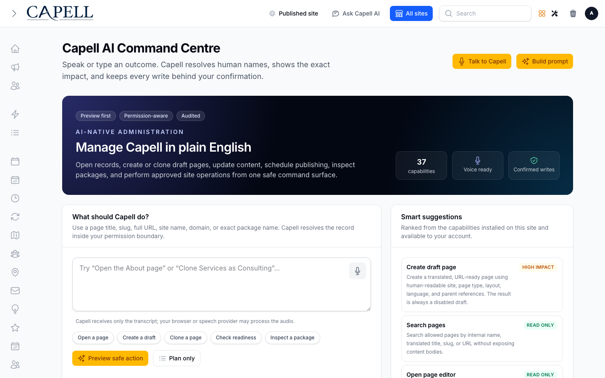

# Agent Bridge

<!-- prettier-ignore-start -->

## What This Plugin Adds

Agent Bridge is an **Available**, **Schema-owning** Capell package in the **Capell AI** product group. It ships as `capell-app/agent-bridge` and extends these surfaces: admin, frontend.

Agent Bridge connects MCP clients to read-only Capell knowledge and a frozen, draft-only site capability contract over per-user HTTP and explicit-user local stdio, with preview confirmation and redacted audit records.

Admins can build scoped prompts and manage a user's client tokens, confirmations, and audit entries. Connected clients can call only the server routes and capabilities enabled for them.

Status details:

- Status: Available
- Tier: premium
- Bundle: ai
- Composer package: `capell-app/agent-bridge`
- Namespace: `Capell\AgentBridge`
- Theme key: not applicable

## Why It Matters

**For developers:** Capability providers register typed operations through CapellAgentBridgeCapabilityProvider, contribute their own deterministic direct-command patterns alongside them, and mutating runs pass through preview, confirmation, policy, and audit Actions.

**For teams:** Agent Bridge is the governed AI connection for Capell: the connected AI client supplies the reasoning, while Agent Bridge limits an agent to approved capabilities, shows a proposed change before execution, and records what each client ran.

## Screens And Workflow

Screenshot contract: `docs/screenshots.json`.

- Agent Bridge prompt builder page (admin, required evidence).
- Token management or setup surface (admin, supplementary evidence).
- Pending capability confirmations (admin, supplementary evidence).
- Audit entry review (admin, supplementary evidence).
- Agent Bridge server health output (admin, supplementary evidence).

## Technical Shape

### Service providers

- `Capell\AgentBridge\Providers\AgentBridgeServiceProvider`

### Config files

- `packages/agent-bridge/config/capell-agent-bridge.php`

### Migrations

- `packages/agent-bridge/database/migrations/2026_05_10_190840_01_create_capell_agent-bridge_tokens_table.php`
- `packages/agent-bridge/database/migrations/2026_05_10_190840_02_create_capell_agent-bridge_confirmations_table.php`
- `packages/agent-bridge/database/migrations/2026_05_10_190840_03_create_capell_agent-bridge_audit_entries_table.php`
- `packages/agent-bridge/database/migrations/2026_05_27_000001_create_capell_agent-bridge_saved_prompts_table.php`
- `packages/agent-bridge/database/migrations/2026_07_09_000001_add_ip_address_hash_to_agent_bridge_audit_entries_table.php`
- `packages/agent-bridge/database/migrations/2026_07_10_000001_drop_plaintext_ip_from_agent_bridge_audit_entries_table.php`
- `packages/agent-bridge/database/migrations/2026_07_20_000001_create_capell_agent_bridge_media_uploads_table.php`
- `packages/agent-bridge/database/migrations/2026_09_29_120000_remove_implicit_timestamp_updates_from_agent_bridge.php`

### Settings migrations

- `packages/agent-bridge/database/settings/2026_05_10_190841_01_add_agent_bridge_settings.php`

### Settings classes

- `AgentBridgeSettings`

### Models

- `CapellAgentBridgeAuditEntry`
- `CapellAgentBridgeConfirmation`
- `CapellAgentBridgeMediaUpload`
- `CapellAgentBridgeSavedPrompt`
- `CapellAgentBridgeToken`

### Filament classes

- `CapellAgentBridgePromptBuilderPage`
- `AgentBridgeAuditEntriesRelationManager`
- `AgentBridgeConfirmationsRelationManager`
- `AgentBridgeTokensRelationManager`
- `AgentBridgeSettingsSchema`

### Livewire components

- `PromptBuilderToolbarAction`

### Route files

- `packages/agent-bridge/routes/agent-bridge.php`

### Extension contracts

- `CapellAgentBridgeCapabilityAction`
- `CapellAgentBridgeCapabilityProvider`

### Actions

- `AuditAgentBridgeCapabilityAction`
- `AuthenticateLocalAgentBridgeClientAction`
- `BuildAgentBridgeCapabilityCatalogAction`
- `BuildAgentBridgePromptAction`
- `ClearCapellCacheCapabilityAction`
- `ConfirmAgentBridgeAdminCapabilityAction`
- `ConfirmAgentBridgeCapabilityAction`
- `ConfirmAgentBridgeMcpV1CapabilityAction`
- `CreateAgentBridgeTokenAction`
- `DeleteAgentBridgePromptAction`
- `FindSavedPromptForUserAction`
- `HashAgentBridgeIpAddressAction`
- `InterpretAgentBridgeCommandAction`
- `InvokeAgentBridgeCapabilityPreviewAction`
- `InvokeAgentBridgeMcpV1CapabilityAction`
- `ListSavedPromptOptionsAction`
- `UploadMediaCapabilityAction`
- `InspectPackageCapabilityAction`
- `InstallPackageCapabilityAction`
- `SearchPackagesCapabilityAction`
- `ClonePageCapabilityAction`
- `CreateDraftPageCapabilityAction`
- `DisablePageCapabilityAction`
- `InspectPageCapabilityAction`
- `InspectPagePublishingReadinessCapabilityAction`
- `ListPageAuthoringOptionsCapabilityAction`
- `OpenPageEditorCapabilityAction`
- `SearchPagesCapabilityAction`
- `TransitionPagePublicationCapabilityAction`
- `UpdateDraftPageCapabilityAction`
- `PrepareAgentBridgeScreenshotAction`
- `PreviewAgentBridgeAdminCapabilityAction`
- `PruneAgentBridgeAuditEntriesAction`
- `QueryAgentBridgeAuditEntriesAction`
- `RevokeAgentBridgeTokenAction`
- `RotateAgentBridgeTokenAction`
- `SaveAgentBridgePromptAction`
- `InspectSiteCapabilityAction`
- `OpenSiteEditorCapabilityAction`
- `SearchSitesCapabilityAction`
- `SuggestAgentBridgeCapabilitiesAction`

### Data objects

- `AgentBridgeCommandPlanData`
- `AgentBridgePromptData`
- `AuthenticatedAgentBridgeClientData`
- `ClearCacheCapabilityInputData`
- `ClonePageCapabilityInputData`
- `CreateDraftPageCapabilityInputData`
- `InstallPackageCapabilityInputData`
- `PackageReferenceCapabilityInputData`
- `PageAuthoringOptionsCapabilityInputData`
- `PageIdCapabilityInputData`
- `PageReferenceCapabilityInputData`
- `SearchPackagesCapabilityInputData`
- `SearchPagesCapabilityInputData`
- `SearchSitesCapabilityInputData`
- `SiteReferenceCapabilityInputData`
- `TransitionPagePublicationCapabilityInputData`
- `UpdateDraftPageCapabilityInputData`
- `UploadMediaCapabilityInputData`
- `CapabilityCommandPatternData`
- `CapabilityData`
- `CapabilityInvocationData`
- `CapabilityResultData`
- `CapabilitySuggestionData`

### Command signatures

- `capell:agent-bridge-prune-audit`

### Scheduled commands

- `capell:agent-bridge-prune-audit (daily; manifest declared)`

### Console command classes

- `PruneAgentBridgeAuditEntriesCommand`

### Manifest contributions

- `admin-page: Capell\AgentBridge\Manifest\AgentBridgeAdminPageContribution`
- `agent-capability: Capell\AgentBridge\Manifest\AgentBridgeBuiltInCapabilitiesContribution`
- `console-command: Capell\AgentBridge\Manifest\AgentBridgeConsoleCommandsContribution`
- `health-check: Capell\AgentBridge\Health\AgentBridgeHealthCheck`
- `migration: Capell\AgentBridge\Manifest\AgentBridgeMigrationsContribution`
- `model: Capell\AgentBridge\Manifest\AgentBridgeModelsContribution`
- `route: Capell\AgentBridge\Manifest\AgentBridgeRoutesContribution`
- `scheduled-job: Capell\AgentBridge\Manifest\AgentBridgeAuditPruneScheduleContribution`
- `schema-extender: Capell\AgentBridge\Manifest\AgentBridgeUserSchemaExtenderContribution`
- `setting: Capell\AgentBridge\Manifest\AgentBridgeSettingsContribution`

### Health checks

- `Capell\AgentBridge\Health\AgentBridgeHealthCheck`

### Blade views

- `packages/agent-bridge/resources/views/filament/pages/prompt-builder.blade.php`
- `packages/agent-bridge/resources/views/livewire/prompt-builder-toolbar-action.blade.php`

## Data Model

- Required tables: `capell_agent_bridge_tokens`, `capell_agent_bridge_confirmations`, `capell_agent_bridge_audit_entries`, `capell_agent_bridge_saved_prompts`, `capell_agent_bridge_media_uploads`.
- Models: `CapellAgentBridgeAuditEntry`, `CapellAgentBridgeConfirmation`, `CapellAgentBridgeMediaUpload`, `CapellAgentBridgeSavedPrompt`, `CapellAgentBridgeToken`.
- Core record references in migrations: `sites via site_id`, `users via user_id`, `media via media_id`.
- Migration files: `2026_05_10_190840_01_create_capell_agent-bridge_tokens_table.php`, `2026_05_10_190840_02_create_capell_agent-bridge_confirmations_table.php`, `2026_05_10_190840_03_create_capell_agent-bridge_audit_entries_table.php`, `2026_05_27_000001_create_capell_agent-bridge_saved_prompts_table.php`, `2026_07_09_000001_add_ip_address_hash_to_agent_bridge_audit_entries_table.php`, `2026_07_10_000001_drop_plaintext_ip_from_agent_bridge_audit_entries_table.php`, `2026_07_20_000001_create_capell_agent_bridge_media_uploads_table.php`, `2026_09_29_120000_remove_implicit_timestamp_updates_from_agent_bridge.php`.
- Migration impact: run host migrations through the package install flow before opening package surfaces.
- Deletion/retention behaviour: migrations declare cascade-on-delete relationships and null-on-delete relationships; retention is scheduled through `capell:agent-bridge-prune-audit` (daily; declared in the manifest).

## Install Impact

- Required packages: `capell-app/admin`, `capell-app/core`.
- Admin navigation: declares `admin-page: AgentBridgeAdminPageContribution`; each Filament page or resource controls its own navigation visibility.
- Admin/editor extensions: `schema-extender: AgentBridgeUserSchemaExtenderContribution`.
- Permissions: `agent-bridge.manage-tokens`, `agent-bridge.view-audit`.
- Public routes: loads `routes/agent-bridge.php`; registers `AgentBridgeRoutesContribution`.
- Database changes: package migrations are declared.
- Config: `config/capell-agent-bridge.php`.
- Settings: `Capell\AgentBridge\Settings\AgentBridgeSettings`.
- Queues or schedules: scheduled commands `capell:agent-bridge-prune-audit (daily; manifest declared)`.
- Cache tags: none declared.
- Commands: `capell:agent-bridge-prune-audit`.

## Common Pitfalls

- Keep required Capell packages on compatible v4 releases: `capell-app/admin`, `capell-app/core`.
- Run migrations before opening package resources or public routes.
- Review package configuration before production-like verification: `config/capell-agent-bridge.php`, `Capell\AgentBridge\Settings\AgentBridgeSettings`.
- Review middleware, throttling, signatures, and public-output safety in `routes/agent-bridge.php` before exposing routes.
- Keep the host Laravel scheduler running so package-registered schedules can execute: `capell:agent-bridge-prune-audit (daily; manifest declared)`.
- Keep public Blade and cached HTML free of authoring markers, model IDs, permissions, signed editor URLs, and lazy database queries.

## Troubleshooting

| Symptom | Likely cause | Check | Fix |
| --- | --- | --- | --- |
| Package surface is missing after install | Provider or manifest is not loaded | Confirm `capell.json`, package `composer.json`, and provider registration | Reinstall the package, refresh Composer autoload, and clear host caches |
| Admin screen or command fails on missing table | Package migrations have not run | Check the tables listed in `Data Model` | Run host migrations and rerun the focused package test |
| Route returns unexpected output | Route cache, middleware, or signed URL setup does not match the package route file | Check the route files listed in `Technical Shape` | Clear route cache and verify middleware before exposing public routes |
| Background work does not run | Queue worker or declared schedule is not active | Check the jobs and scheduled commands listed in `Technical Shape` | Start the queue worker or host scheduler, then run the focused command or package test |
| Public output leaks unexpected state | Render data, cache variation, or authoring boundary has regressed | Check public Blade, cache tags, and public-output safety tests | Move data loading out of Blade and rerun the package public-output tests |

## Quick Start

1. Install the package: `composer require capell-app/agent-bridge`.
2. Open the package admin surface at `/admin/agent-bridge/capell-agent-bridge/prompt-builder` and confirm Agent Bridge is available.

## Next Steps

- [Package docs](docs/README.md)
- [Overview](docs/overview.md)
- [Worked extension examples](docs/extension-contracts.md)
- Configuration files: [`config/capell-agent-bridge.php`](config/capell-agent-bridge.php).
- [Troubleshooting](#troubleshooting)
- [Screenshot contract](docs/screenshots.json)
- [Marketplace assets](docs/assets/marketplace/)
- [Capell content language plan](../../docs/CONTENT_LANGUAGE_PLAN.md)
- [Capell documentation design system](../../docs/DESIGN_SYSTEM.md)
- [Capell and package ERD notes](../../docs/erd/capell-and-package-erds.md)

<!-- prettier-ignore-end -->
