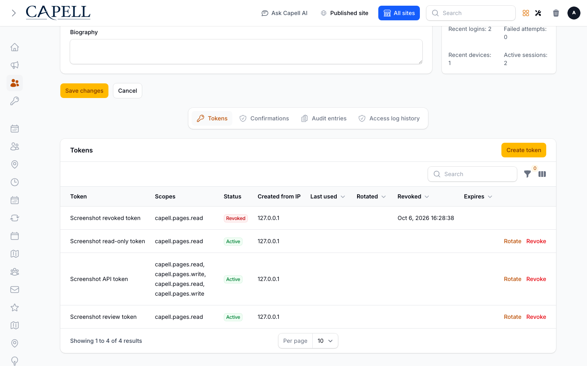

# Agent Bridge

<!-- prettier-ignore-start -->

Anyone on your team who uses Claude, Cursor or another AI assistant can let it search your pages and draft changes to them, though it cannot publish. Each person can be given a personal key that says what their assistant may do, and the assistant acts as that person.

A connected assistant can create or update drafts and upload images of up to about 2 MB. Every change comes with a preview first. For drafts and uploads, you approve that exact preview from your user page in Capell admin, then the assistant confirms it within an hour by default. Saving a scratch draft in the page editor, which visitors never see, needs only the assistant's own confirmation. Agent Bridge has no AI of its own and works with an assistant you already use.

Administrators get a screen of their own where they type a request, check what it will do and confirm it. It recognises a fixed set of commands and uses no AI. Every key expires. By default a new key lasts 90 days and can't be set to last more than a year, though your developer can change both limits. Keys can be replaced or withdrawn sooner, and each one is kept in scrambled form. Administrators can read a record of every action afterwards, with secrets hidden.

- **Price and availability:** Check current availability and price on the [Capell Marketplace listing](https://capell.app/marketplace/extensions/agent-bridge).
- **Licence:** Published under MIT in `composer.json`.
- **Requires:** `PHP ^8.4`, `capell-app/admin ^1.0.72`, `capell-app/core ^1.0.78`, `laravel/framework ^12.61.1|^13.12.0`, `laravel/mcp ^0.6|^0.7|^0.9|^1.0`, `lorisleiva/laravel-actions ^2.8`, `spatie/laravel-data ^4.5`, `spatie/laravel-package-tools ^1.14.1`.
- **Install:** `composer require capell-app/agent-bridge`.

## Quick Start

1. Install the package: `composer require capell-app/agent-bridge`.
2. Open the package admin surface at `/admin/agent-bridge/capell-agent-bridge/prompt-builder` and confirm Agent Bridge is available.

## For Developers

Capability providers register typed operations through CapellAgentBridgeCapabilityProvider, contribute their own deterministic direct-command patterns alongside them, and mutating runs pass through preview, confirmation, policy, and audit Actions.

## Configure

- **Configuration files:** `config/capell-agent-bridge.php`.
- **Admin settings:** `Capell\AgentBridge\Settings\AgentBridgeSettings`.
- **Commands:** `php artisan capell:agent-bridge-prune-audit`, `php artisan capell:agent:connect`.

## Limits And Pitfalls

- Install the required Capell packages at the versions in `composer.json`: `capell-app/admin ^1.0.72`, `capell-app/core ^1.0.78`.
- Run migrations before opening package resources or public routes.
- Review middleware, throttling, signatures, and public-output safety in `routes/agent-bridge.php` before exposing routes.
- Keep the host Laravel scheduler running so package-registered schedules can execute: `capell:agent-bridge-prune-audit (daily; manifest declared)`.
- Keep public Blade and cached HTML free of authoring markers, model IDs, permissions, signed editor URLs, and lazy database queries.

## Screens And Workflow

- Agent Bridge prompt builder page (admin).
- Token management or setup surface (admin).
- Pending capability confirmations (admin).
- Audit entry review (admin).
- Agent Bridge user resource settings (admin).

## Install Impact

- Required packages: `capell-app/admin`, `capell-app/core`.
- Admin navigation: declares `admin-page: AgentBridgeAdminPageContribution`; each Filament page or resource controls its own navigation visibility.
- Admin/editor extensions: `schema-extender: AgentBridgeUserSchemaExtenderContribution`.
- Permissions: `agent-bridge.manage-tokens`, `agent-bridge.view-audit`.
- Public routes: loads `routes/agent-bridge.php`; registers `AgentBridgeRoutesContribution`.
- Database changes: package migrations are declared.
- Config: `config/capell-agent-bridge.php`.
- Settings: `Capell\AgentBridge\Settings\AgentBridgeSettings`.
- Queues or schedules: scheduled commands `capell:agent-bridge-prune-audit (daily; manifest declared)`.
- Cache tags: none declared.
- Commands: `capell:agent-bridge-prune-audit`, `capell:agent:connect`.

## Troubleshooting

| Symptom | Likely cause | Check | Fix |
| --- | --- | --- | --- |
| Package surface is missing after install | Provider or manifest is not loaded | Confirm `capell.json`, package `composer.json`, and provider registration | Reinstall the package, refresh Composer autoload, and clear host caches |
| Admin screen or command fails on missing table | Package migrations have not run | Check the tables listed in `Data Model` | Run host migrations and rerun the focused package test |
| Route returns unexpected output | Route cache, middleware, or signed URL setup does not match the package route file | Check the route files listed in `Technical Shape` | Clear route cache and verify middleware before exposing public routes |
| Background work does not run | Queue worker or declared schedule is not active | Check the jobs and scheduled commands listed in `Technical Shape` | Start the queue worker or host scheduler, then run the focused command or package test |
| Public output leaks unexpected state | Render data, cache variation, or authoring boundary has regressed | Check public Blade, cache tags, and public-output safety tests | Move data loading out of Blade and rerun the package public-output tests |

## Upgrading

No manual steps between minor versions.

Read [CHANGELOG.md](CHANGELOG.md) before upgrading.

## Next Steps

- [Package docs](docs/README.md)
- [Overview](docs/overview.md)
- [Worked extension examples](docs/extension-contracts.md)
- Configuration files: [`config/capell-agent-bridge.php`](config/capell-agent-bridge.php).
- [Troubleshooting](#troubleshooting)
- [Developer reference](docs/reference.md)
- [Marketplace assets](docs/assets/marketplace/)
- [Capell content language plan](../../docs/CONTENT_LANGUAGE_PLAN.md)
- [Capell documentation design system](../../docs/DESIGN_SYSTEM.md)
- [Capell and package ERD notes](../../docs/erd/capell-and-package-erds.md)
- Related packages: [Navigation](../navigation/README.md).

<!-- prettier-ignore-end -->
